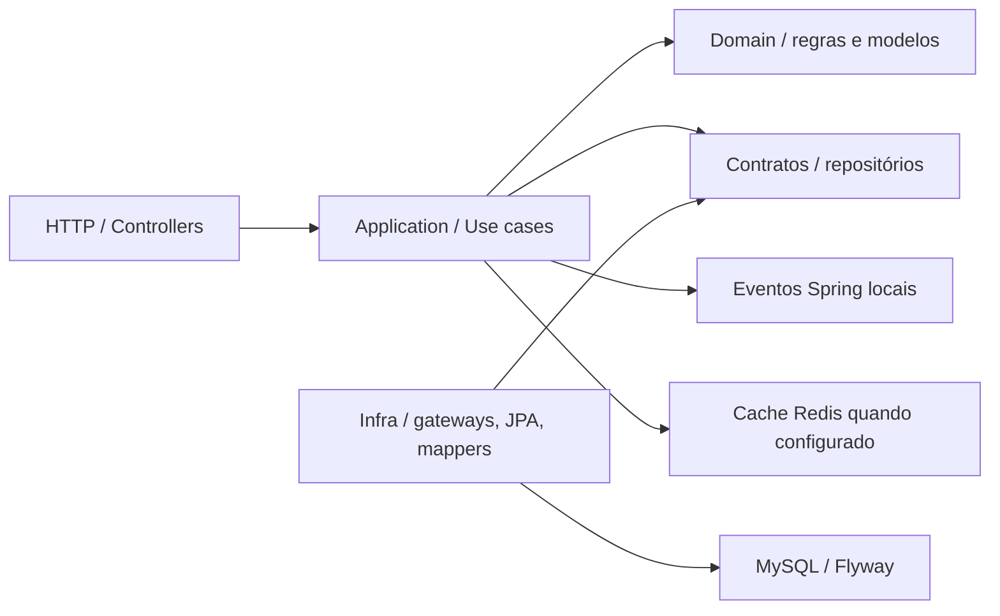

# Arquitetura e guia do código

Esta documentação descreve a implementação encontrada em `src/main/java/com/cleancode/ecommerce`. O README e os ADRs registram objetivos e decisões; quando houver diferença, as páginas dos módulos apontam o comportamento observado no código.

## Visão geral

A aplicação é um backend Java 25 com Spring Boot 3.5, organizado por capacidade de negócio. O pacote raiz é `com.cleancode.ecommerce`; os módulos mantêm variações próprias de estrutura, então não se deve presumir que todos implementem exatamente as mesmas camadas.

As interfaces de repositório ficam em geral junto ao domínio, com implementações JPA em `infra/gateway` e modelos de banco em `infra/persistence` (há variações de grafia e organização). Controllers convertem requisições HTTP em chamadas a contratos de aplicação. O domínio concentra entidades, tipos e regras; a aplicação coordena operações entre módulos.

## Navegação por módulo

| Módulo | Conteúdo |
|---|---|
| [adm](architecture/adm.md) | Administração, relatórios, clientes, pedidos, vouchers e substituições |
| [cart](architecture/cart.md) | Carrinho, itens, integração com catálogo e reservas de estoque |
| [customer](architecture/customer.md) | Cadastro, perfil, endereços, cartões e elegibilidade |
| [event](architecture/event.md) | Eventos locais e reações entre módulos |
| [order](architecture/order.md) | Pedidos, itens, estados, listagem, cancelamento e entrega |
| [payment](architecture/payment.md) | Checkout, pagamento e estratégias |
| [product](architecture/product.md) | Catálogo, produtos, preço e ativação |
| [promotional](architecture/promotional.md) | Vouchers e descontos |
| [replacement](architecture/replacement.md) | Solicitações de troca/substituição |
| [shared](architecture/shared.md) | Segurança, kernel compartilhado, erros e utilitários |
| [stock](architecture/stock.md) | Estoque, entradas, saídas e reservas |
| [user](architecture/user.md) | Autenticação e representação de usuário |

## Fluxo de checkout observado

`PaymentController` encaminha `POST /payment/checkout` para `Checkout.execute`. A implementação busca cliente e carrinho, obtém o endereço de entrega principal, monta pedido e itens, calcula o total, seleciona uma estratégia de pagamento, processa o pagamento, confirma reservas de estoque, persiste pedido/pagamento, limpa o carrinho e publica `OrderEvent`. Em falha de pagamento, persiste pedido e pagamento rejeitado e lança erro. As chamadas não estão envolvidas por uma transação explícita nessa classe; consulte a configuração e os adapters antes de assumir atomicidade.

Detalhes e referências estão em [payment](architecture/payment.md), [order](architecture/order.md), [cart](architecture/cart.md), [stock](architecture/stock.md) e [event](architecture/event.md).

## Arquitetura pretendida e implementação

Os [ADRs](adr/README.md) explicam decisões pretendidas. A implementação tem diferenças de nomenclatura e estrutura entre módulos, eventos baseados em Spring no mesmo processo e um gateway de pagamento fake. Cada página de módulo identifica os pontos confirmados pelo código e evita tratar decisões documentadas como prova de comportamento.

## Como manter esta documentação

Ao alterar um módulo, atualize sua página, os fluxos que cruzam outros módulos e este índice se a navegação mudar. Use os nomes reais dos tipos, links relativos para código/testes e registre lacunas em vez de inferir regras. O catálogo de casos de uso é baseado em classes e endpoints encontrados; regras detalhadas só devem ser descritas após ler sua implementação.

## Referências

- [README do projeto](../../README.md)
- [Decisões arquiteturais](architecture-decisions.md)
- [Índice de ADRs](adr/README.md)
- [Fonte Java](../../src/main/java/com/cleancode/ecommerce/)
